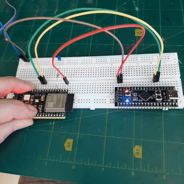

# emb16-homework

## Модуль 4.1 - UART комунікація між мікроконтролерами

### Хід роботи:
1. Зібрано систему з двох мікроконтролерів ESP32 та STM32, кожен із кнопкою та світлодіодом.
2. У проєкті ESP32 створено прошивку, що реалізує наступний алгоритм:
     - розроблено функцію init_hw() для налаштування GPIO та UART;
     - створено окрему задачу FreeRTOS button_task() для опитування кнопки та програмного антибрязкоту;
     - при натисканні кнопки ESP32 через UART передається команда перемикання світлодіода;
     - створено задачу uart_receive_task() для приймання команд від STM32 та перемикання локального світлодіода.
3. У STM32CubeMX налаштовано GPIO для кнопки та світлодіода, а також UART у асинхронному режимі з параметрами 115200 8N1 і перериванням для приймання даних.
4. У [STM32 частині проекту](https://github.com/Telepatrick/stm32-uart-data-exchange-esp32) реалізовано:
     - програмний антибрязкіт кнопки;
     - передавання команди через UART при натисканні кнопки;
     - приймання даних через HAL_UART_Receive_IT();
     - обробку отриманої команди у HAL_UART_RxCpltCallback();
     - перемикання стану світлодіода при отриманні команди.

### Результат:
Під час виконання роботи опановано принцип двосторонньої UART-комунікації між ESP32 та STM32, роботу з UART-перериваннями, створення задач FreeRTOS та програмну обробку натискання кнопок.

У результаті натискання кнопки на ESP32 змінює стан світлодіода на STM32, а натискання кнопки на STM32 змінює стан світлодіода на ESP32.
Приклад роботи надано у .gif анімації:
