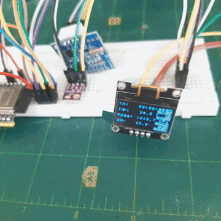

# emb16-homework

## Зчитування складних даних: робота з регістрами та бібліотеками для I2C-сенсорів

### Хід роботи:
1. Зібрано схему з OLED-дисплеєм SSD1315, годинником реального часу DS1307 та метеодатчиком BME280, підключеними до спільної шини I2C мікроконтролера ESP32.
2. У файлах проекту реалізовано модульну структуру:
   - Ініціалізація шини I2C [main.c](src/main.c): Налаштовано майстер-шину I2C та зареєстровано три пристрої - SSD1315, DS1307, BME280;
   - Модуль RTC [ds1307.c](components/ds1307/ds1307.c): Реалізовано зчитування часу з регістра RTC та конвертацію даних з BCD-коду у десяткові значення;
   - Модуль датчика [bme280.c](components/bme280/bme280.c): Реалізовано зчитування заводських калібрувальних коефіцієнтів та формулы компенсації для обчислення точних значень температури, атмосферного тиску та відносної вологості;
   - Драйвер дисплея [ssd1315.c](components/ssd1315/ssd1315.c), [font8x8.c](components/font8x8/font8x8.c): Написано функції ініціалізації, очищення GDDRAM та посторінкового виведення символьних рядків за допомогою базового растрового шрифту;
   - Головний цикл app_main: Налаштовано періодичне оновлення показників часу та метеоданих на OLED-екрані.

### Результат:
Опановано роботу з шиною I2C при одночасному підключенні кількох периферійних пристроїв. Реалізовано автономну метеостанцію з відображенням поточного часу DS1307 та параметрів навколишнього середовища BME280 на OLED-дисплеї SSD1315.

Приклад роботи надано у .gif-анімації
